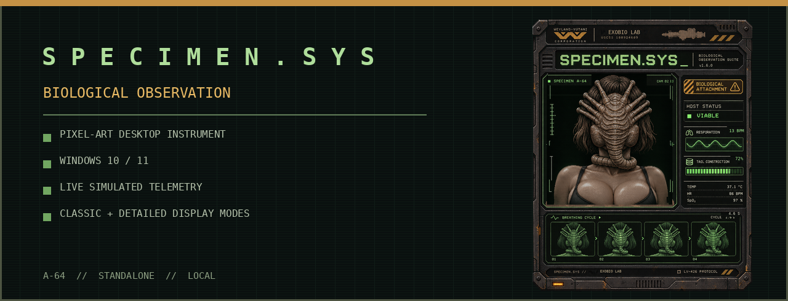
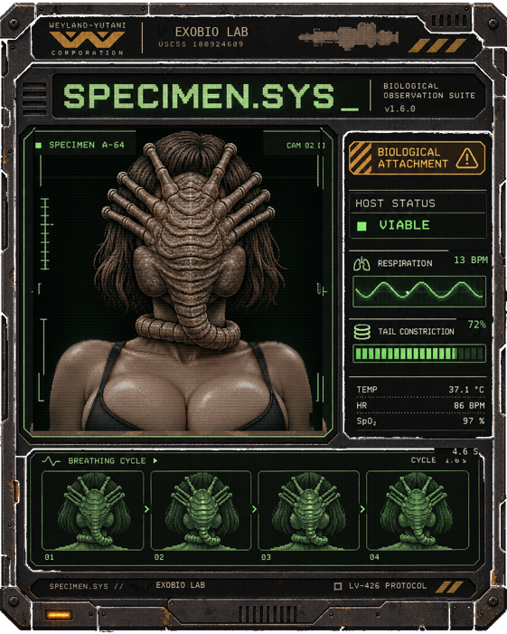
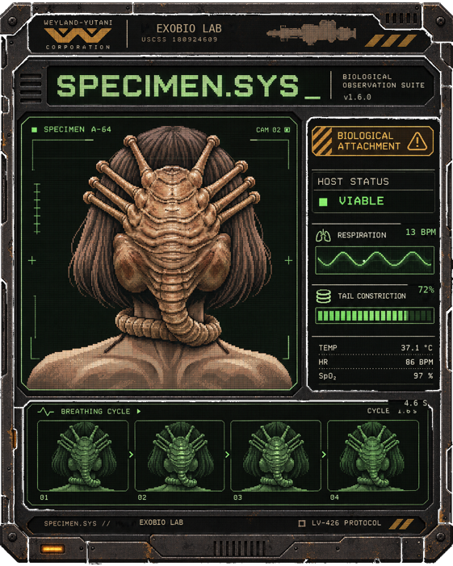
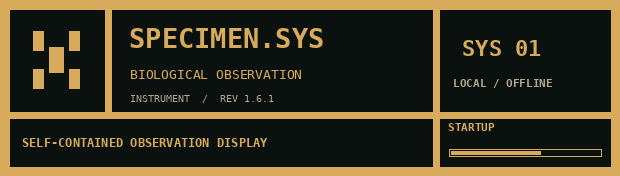
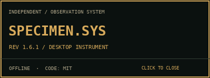

<div align="center">
  

# SPECIMEN.SYS

**A standalone pixel-art biological observation instrument for Windows.**


A fictional organism, a living host, and a quiet CRT diagnostic console. Built as a desktop widget, not a wallpaper or a GIF.
</div>

## See it in action

| Detailed display | Classic v1.0 display |
|:---:|:---:|
|  |  |
| [Animated preview](docs/images/detailed-animation.webp) | [Animated preview](docs/images/classic-animation.webp) |

## Features

- **Two built-in display styles.** Detailed and Classic v1.0, selectable from `Display → Display style`.
- **Layered specimen movement.** Host breathing, membranes, abdominal flexion, grip tension, and occasional tail constriction.
- **Responsive fictional telemetry.** Respiratory indicator, rate, constriction meter, and four-stage breathing strip share a simulation state.
- **True desktop behaviour.** Frameless, transparent exterior, movable, three sizes, optional always-on-top, optional click-through, and system tray recovery.
- **Tiny cinematic touches.** A silent 2-second startup screen, restrained rolling CRT line, and fully borderless About panel.
- **Local and offline.** No account, telemetry collection, background service, or runtime network connection.

### Windows requirements

Windows 10/11 x64. Use the downloadable `.zip` from [GitHub Releases](../../releases) for a prebuilt version **when available**, or install Python 3.11+ and use the source instructions below. Releases built without an Authenticode certificate may trigger Windows SmartScreen warnings.

### Run from source

1. Download or clone the repository.
2. Run `INSTALL.cmd` once. This creates a local `.venv` and installs PySide6.
3. Run `RUN-SPECIMEN.cmd`. The widget opens following its silent 2-second splash.
4. **Right-click** the frame for Display, Animation, Preferences, and Quit. The notification-area icon provides recovery if click-through is enabled.

To make a Windows executable, run `BUILD-EXE.cmd`. The resulting **tray-only** PyInstaller app will be at `dist\SPECIMEN.SYS\SPECIMEN.SYS.exe`. Use `RUN-DEBUG.cmd` if startup fails (it explicitly enables private local diagnostic logs; redact logs before sharing). The ordinary app uses `pythonw` and `Qt.Tool` to avoid a console and standard taskbar button; Windows behaviour should be verified on each release.

### Controls

| Control | Action |
|---|---|
| Left-drag the metal bezel | Move the widget |
| Right-click | Open the context menu |
| Display → Widget size | Compact (449×561), Standard (561×701), Large (701×876) |
| Display → Display style | Detailed / Classic v1.0 |
| Display → Rolling CRT refresh | Optional subtle rolling display line |
| Animation | Pause / Resume, intensity, reduced motion |
| Preferences | Startup, splash, monitor recovery |
| Tray icon | Show, pause, disable click-through, hide, quit |

### Startup and About

| Silent splash | Borderless About |
|:---:|:---:|
|  |  |

The startup plate lasts approximately two seconds and fades out quietly. It is a small, code-drawn industrial equipment label, not a pre-rendered illustration or fake boot log. The borderless About plaque closes when clicked or when Escape is pressed. Both use the installed palette and remain separate from the specimen display. No audio or standard taskbar window is used.

## Design

The metal chassis is static art, the character is a set of masked animation layers, and the diagnostic areas update from the same biological simulation. The shell never needs to be re-generated just to modify motion. The data values are **fictional**, not clinical measurements. Visual consistency and restrained motion take precedence over excessive effects.

## Privacy and source layout

The application reads local settings; persistent diagnostic logs are disabled by default and can be enabled explicitly for troubleshooting. It does not connect to external services. See [PRIVACY.md](PRIVACY.md) and [SECURITY.md](SECURITY.md).

```text
specimen_sys/       GUI, simulation, code-drawn equipment plates and compositor
specimen_sys/assets/  display images and sprite layers
branding/           high-resolution application and tray icons
scripts/            release verification and diagnostics
tests/              regression and safety checks
docs/images/        real widget screenshots, previews and social artwork
.github/workflows/  automated Windows validation and tagged builds
```

## Unofficial visual tribute

This is an independent fictional science-fiction art project. It is not affiliated with any entertainment studio or rightsholder. Recognizable science-fiction motifs or marks depicted in the visuals remain the property of their respective owners. The [MIT license](LICENSE) covers **source code only**; see [ASSETS.md](ASSETS.md) before reusing artwork.

Contributions are welcome. Please read [CONTRIBUTING.md](CONTRIBUTING.md) and use GitHub Issues for bugs, rendering differences, and accessibility requests.
